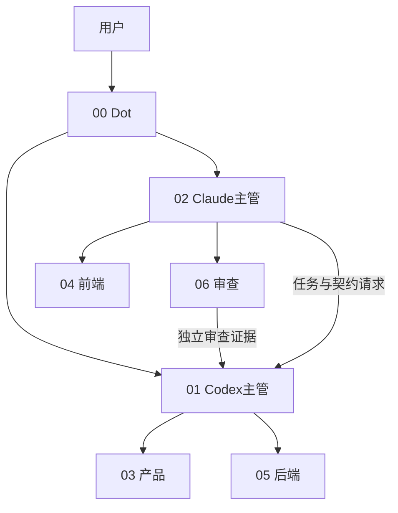

# Forma 七人员工

更新2026-10-21。以下恰为七个活跃配置身份，不表示七个会话在运行。唯一职责定义在编号MD，工具适配器与current仅引用。

| 编号 | ID | 名称 | 工具 | 协调关系 | 唯一MD |
|---|---|---|---|---|---|
| 00 | dot | Dot总协调 | Dot（羊羊） | 用户；汇总01与02的证据汇报 | [00-dot](agent-prompts/00-dot.md) |
| 01 | lead | Codex项目主管 | Codex | 向Dot与用户汇报；协调03与05，接收02的请求 | [01-codex-lead](agent-prompts/01-codex-lead.md) |
| 02 | claude-lead | Claude Code项目主管 | Claude Code | 向Dot与用户汇报；协调04与06，向01请求正式任务与契约调整 | [02-claude-lead](agent-prompts/02-claude-lead.md) |
| 03 | product | 产品经理 | Codex独立会话（建议） | 01协调；与02核对体验要求，向Dot澄清目标 | [03-product](agent-prompts/03-product.md) |
| 04 | frontend | 前端工程师 | Claude Code独立会话（建议） | 02协调；契约变更交01；与03核对体验 | [04-frontend](agent-prompts/04-frontend.md) |
| 05 | backend | 后端工程师 | Codex独立会话（建议） | 01协调；领域行为由03定义，06独立验证 | [05-backend](agent-prompts/05-backend.md) |
| 06 | qa | 独立审查员 | Claude Code独立会话（建议） | 02安排；可直接向01、02、Dot报告，独立于实现会话 | [06-reviewer](agent-prompts/06-reviewer.md) |

四个执行岗位各一人。01维护唯一任务板与共享契约/依赖/最终集成，02维护自己的调度并请求01登记。通常单个任务按需选2–4人，不自动启动全员。独立员工默认独立会话；06独立于实现者，直接向两主管与Dot报告也有效。

退休职责：UX→03/04；Research→03/01/02；Security→06，修复归实现者；Release→01/02；Rules→05实现、03定义、06验证。历史目录保留；旧writer未核实前不擅自接管。

## 路径索引

每人current入口为`agent-prompts/current/<ID>.md`；记忆为`memory/<ID>/{PROFILE,MEMORY,HANDOFF}.md`；状态为`status/<ID>.md`。启动Prompt见[START-PROMPTS](START-PROMPTS.md)，工作目录见[WORKSPACES](WORKSPACES.md)，技能见[SKILLS-MATRIX](SKILLS-MATRIX.md)。

## 协作关系

该图是职责关系，未接通自动通信。
